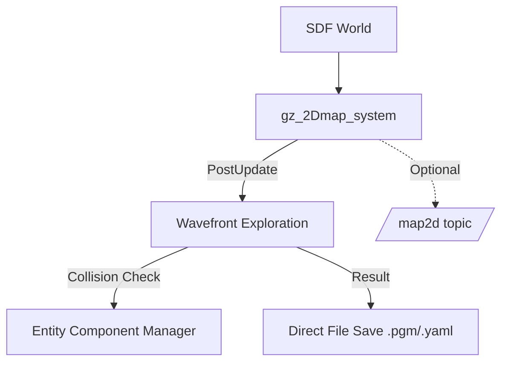

# Gazebo ROS 2 2D Map Plugin (Fortress + Garden/Harmonic, personal fork)

**Automatically generate 2D occupancy maps from Ignition/Gazebo Sim worlds for ROS 2.**

This Gazebo system plugin creates occupancy grid maps for robot navigation without running SLAM. It works by slicing the Gazebo world at a configurable height and identifies obstacles through AABB collision detection.

Unlike the original Gazebo Classic plugin, this version saves maps directly to PGM/YAML files to bypass communication limitations, and now builds against **either** Ignition Gazebo Fortress (gz-sim6) **or** Gazebo Garden/Harmonic (gz-sim7/8) — whichever is installed.

## About This Fork / Branch

This `harmonic-port` branch is a personal fork of [robotics-upo/gazebo_ros2_2Dmap_plugin](https://github.com/robotics-upo/gazebo_ros2_2Dmap_plugin) (`fortress` branch), kept as a record of the changes I made to get it building on my own setup — **not** intended to be merged upstream.

**Why I forked it:** the upstream `fortress` branch only targets Ignition Gazebo Fortress (`ignition::` namespace, gz-sim6). My workspace moved to Gazebo Harmonic (gz-sim8) as part of the [`gazebo_world_generator`](https://github.com/seoyoung9220/gazebo_world_generator) Jazzy/Harmonic port I did alongside this, and Fortress is end-of-life, so the plugin needed to build against the current `gz-sim` API as well.

**What I changed, and why:**

- **Added dual namespace support instead of a hard fork of the namespace.** `CMakeLists.txt` already auto-detects `gz-sim8` → `gz-sim7` → `ignition-gazebo6` and sets `GZ_PREFIX` accordingly; I added a `target_compile_definitions(... GZ_2DMAP_USE_GZ_NAMESPACE)` when `GZ_PREFIX` is `"gz"`. `include/gz_2Dmap_system.hh` and `src/gz_2Dmap_system.cc` then branch on that macro to pick `gz/...` headers + `gz::` namespace (Garden/Harmonic) or `ignition/...` headers + `ignition::` namespace (Fortress) — so the same source builds unmodified on whichever Gazebo version is installed, instead of needing a separate branch per version.
- **Unified the logging/plugin macros behind `GZ2D_*` defines** (`GZ2D_MSG`, `GZ2D_ERR`, `GZ2D_WARN`, `GZ2D_DBG`, `GZ2D_ADD_PLUGIN`, `GZ2D_ADD_PLUGIN_ALIAS`), since Fortress uses `ignmsg`/`IGNITION_ADD_PLUGIN` while Garden/Harmonic renamed these to `gzmsg`/`GZ_ADD_PLUGIN`.
- **Registered the plugin under both alias spellings** (`ignition::gazebo::systems::OccupancyMapFromWorld` and `gz::sim::systems::OccupancyMapFromWorld`), so a world file written for either Fortress or Harmonic can load this plugin by name without edits.
- **Made `generate_map.sh` detect `ign gazebo` vs `gz sim` at runtime** and pick the matching message package (`ignition.msgs` vs `gz.msgs`) and service/topic commands, rather than hardcoding Fortress's `ignition.msgs.Empty`.
- **Added `~/.gz/models` to the resource path search**, alongside the existing `~/.gazebo/models`, since Harmonic's Fuel cache lives under the former.
- **Kept the Gazebo debug log on failure** instead of always deleting it in the `cleanup()` trap — I was hitting enough version-mismatch failures while porting that I wanted `/tmp/gazebo_map_gen.log` to survive for inspection when generation doesn't succeed.

If you're specifically on Ignition Fortress and don't need Harmonic/Garden support, the upstream `fortress` branch is simpler and is what this was based on.

## Features

- **Automatic map generation** from any Gazebo/Ignition world.
- **Direct file saving**: Saves map to `.pgm` and `.yaml` immediately (no ROS 2 bridge required for generation).
- **Auto-detection** of world bounds (no manual sizing needed).
- **Rotation-aware**: Correctly detects rotated objects (like walls).
- **Fully automated** script for plugin injection and map generation.
- **Builds against Ignition Fortress (gz-sim6) or Gazebo Garden/Harmonic (gz-sim7/8)** — auto-detected at CMake configure time, no manual flag needed.
- **ROS 2 Humble** (Fortress) or **ROS 2 Jazzy** (Harmonic) compatible.

## Quick Start

### Installation

```bash
cd ~/ros2_ws/src
git clone -b harmonic-port https://github.com/seoyoung9220/gazebo_ros2_2Dmap_plugin.git
cd ~/ros2_ws
colcon build --packages-select gazebo_ros2_2dmap_plugin
source install/setup.bash
```

CMake auto-detects whatever Gazebo Sim version is installed (`gz-sim8` → `gz-sim7` → `ignition-gazebo6`, in that order) and builds against it — no manual configuration needed either way.

### Automated Generation (Recommended)

The easiest way - automatically injects the plugin into your world and generates the map:

```bash
# Basic usage
ros2 run gazebo_ros2_2dmap_plugin generate_map.sh <world_file> [output_dir]

# Example
ros2 run gazebo_ros2_2dmap_plugin generate_map.sh ~/my_world.sdf ~/maps
```

**Output:** Creates `my_world.yaml` and `my_world.pgm` in the specified directory.

The script performs these steps automatically:
1.  Detects if the plugin is in the world file (injects it temporarily if missing).
2.  Launches Ignition Gazebo in server mode (headless).
3.  Triggers map generation via Ignition Transport service.
4.  Waits for the plugin to save the files directly to disk.
5.  Cleans up the temporary files.

## Configuration

### Plugin Parameters

| Parameter | Default | Description |
|-----------|---------|-------------|
| `map_resolution` | 0.05 | Cell size in meters (0.1m recommended for large worlds). |
| `map_height` | 0.3 | Height to slice the world in meters. |
| `map_size_x` | auto | Map width (omit for auto-detection). |
| `map_size_y` | auto | Map height (omit for auto-detection). |
| `map_margin` | 2.0 | Extra space in meters around auto-detected bounds. |
| `init_robot_x` | 0.0 | Starting X coordinate for exploration (must be free space). |
| `init_robot_y` | 0.0 | Starting Y coordinate for exploration (must be free space). |
| `output_path` | - | Base path for saving the `.pgm` and `.yaml` files. |

## Troubleshooting

### Map is all empty (white) or missing walls
- **Check Collisions**: The plugin detects obstacles using **collision geometries**. If your world models (like walls) only have `<visual>` elements but no `<collision>` elements, they will not be detected.
- **Map Height**: Ensure `map_height` (default 0.3) actually intersects with your obstacles.

### Map is all gray (unknown)
- **Start Position**: Ensure `init_robot_x/y` is in **free space**. If it starts inside a wall, the wavefront expansion will fail immediately.

### Generation times out
- For very large worlds (e.g., 100x100m) at high resolution (0.05), generation can take over 30 seconds. Try increasing `map_resolution` to 0.1 for faster results.

## Architecture

This plugin uses Ignition Gazebo's Entity-Component-System (ECS) architecture.



## Credits and License

This package is licensed under the MIT License.

Forked from [marinaKollmitz/gazebo_ros_2Dmap_plugin](https://github.com/marinaKollmitz/gazebo_ros_2Dmap_plugin), originally based on ETH Zürich's [octomap plugin](https://github.com/ethz-asl/rotors_simulator/tree/master/rotors_gazebo_plugins). [robotics-upo/gazebo_ros2_2Dmap_plugin](https://github.com/robotics-upo/gazebo_ros2_2Dmap_plugin) (`fortress` branch) added ROS 2 Humble support, Ignition Gazebo Fortress compatibility, automatic map sizing, and automated generation scripts.

This `harmonic-port` branch is a further personal fork by [seoyoung9220](https://github.com/seoyoung9220) adding Gazebo Garden/Harmonic (gz-sim7/8) support alongside the existing Fortress support — see [About This Fork / Branch](#about-this-fork--branch) above.
