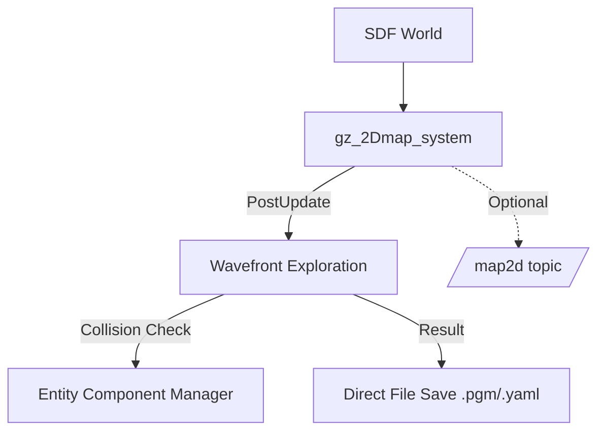

# Gazebo ROS 2 2D Map Plugin (Fortress + Garden/Harmonic, 개인 포크)

**ROS 2용으로 Ignition/Gazebo Sim 월드에서 2D occupancy map을 자동 생성합니다.**

이 Gazebo 시스템 플러그인은 SLAM을 돌리지 않고도 로봇 내비게이션용 occupancy grid 맵을 생성합니다. Gazebo 월드를 설정 가능한 높이에서 슬라이스하고, AABB 충돌 검사로 장애물을 식별하는 방식입니다.

원본 Gazebo Classic 플러그인과 달리, 이 버전은 통신 제약을 피하기 위해 맵을 PGM/YAML 파일로 직접 저장하며, 이제 Ignition Gazebo Fortress(gz-sim6)**와** Gazebo Garden/Harmonic(gz-sim7/8) **둘 다** — 설치된 버전에 맞춰 — 빌드됩니다.

## 이 포크/브랜치에 대해

이 `harmonic-port` 브랜치는 [robotics-upo/gazebo_ros2_2Dmap_plugin](https://github.com/robotics-upo/gazebo_ros2_2Dmap_plugin)의 `fortress` 브랜치를 개인적으로 포크한 것으로, 제 환경에서 빌드되게 만든 변경 내역을 기록으로 남겨둔 것입니다. **upstream에 머지할 목적이 아닙니다.**

**왜 포크했는가:** upstream의 `fortress` 브랜치는 Ignition Gazebo Fortress(`ignition::` 네임스페이스, gz-sim6)만 대상으로 합니다. 제 작업 환경은 함께 진행한 [`gazebo_world_generator`](https://github.com/seoyoung9220/gazebo_world_generator)의 Jazzy/Harmonic 포팅 작업의 일환으로 Gazebo Harmonic(gz-sim8)으로 옮겨졌고, Fortress는 수명이 끝난(EOL) 상태라서, 이 플러그인도 현재의 `gz-sim` API로 빌드되게 만들 필요가 있었습니다.

**무엇을, 왜 바꿨는지:**

- **네임스페이스를 아예 분리된 포크로 만드는 대신, 듀얼 네임스페이스 지원을 추가.** `CMakeLists.txt`는 이미 `gz-sim8` → `gz-sim7` → `ignition-gazebo6` 순으로 자동 감지해서 `GZ_PREFIX`를 설정하고 있었는데, 여기에 `GZ_PREFIX`가 `"gz"`일 때 `target_compile_definitions(... GZ_2DMAP_USE_GZ_NAMESPACE)`를 추가했습니다. `include/gz_2Dmap_system.hh`와 `src/gz_2Dmap_system.cc`는 이 매크로를 기준으로 `gz/...` 헤더 + `gz::` 네임스페이스(Garden/Harmonic) 또는 `ignition/...` 헤더 + `ignition::` 네임스페이스(Fortress)를 분기 선택합니다. 즉, 버전마다 브랜치를 따로 둘 필요 없이 같은 소스가 설치된 Gazebo 버전에 맞춰 그대로 빌드됩니다.
- **로깅/플러그인 매크로를 `GZ2D_*` 정의로 통일** (`GZ2D_MSG`, `GZ2D_ERR`, `GZ2D_WARN`, `GZ2D_DBG`, `GZ2D_ADD_PLUGIN`, `GZ2D_ADD_PLUGIN_ALIAS`). Fortress는 `ignmsg`/`IGNITION_ADD_PLUGIN`을 쓰는데 Garden/Harmonic에서는 `gzmsg`/`GZ_ADD_PLUGIN`으로 이름이 바뀌었기 때문입니다.
- **플러그인을 두 가지 별칭 모두로 등록** (`ignition::gazebo::systems::OccupancyMapFromWorld`와 `gz::sim::systems::OccupancyMapFromWorld`). Fortress용이든 Harmonic용이든 작성된 월드 파일을 수정 없이 그대로 로드할 수 있게 됩니다.
- **`generate_map.sh`가 실행 시점에 `ign gazebo`인지 `gz sim`인지 자동 감지**하도록 수정하고, 그에 맞는 메시지 패키지(`ignition.msgs` vs `gz.msgs`)와 서비스/토픽 커맨드를 선택하게 했습니다. 기존에는 Fortress의 `ignition.msgs.Empty`가 하드코딩되어 있었습니다.
- **리소스 경로 검색에 `~/.gz/models` 추가**, 기존 `~/.gazebo/models`와 함께 검색합니다. Harmonic의 Fuel 캐시가 전자 경로에 저장되기 때문입니다.
- **실패 시에도 Gazebo 디버그 로그를 지우지 않도록 수정.** 기존엔 `cleanup()` 트랩에서 항상 로그를 삭제했는데, 포팅 중에 버전 불일치로 인한 실패를 꽤 많이 겪어서 생성이 실패했을 때 `/tmp/gazebo_map_gen.log`를 남겨서 확인할 수 있게 했습니다.

Ignition Fortress만 쓰고 Harmonic/Garden 지원이 필요 없다면, 이 포크의 기반이 된 upstream의 `fortress` 브랜치가 더 단순하니 그쪽을 쓰세요.

## 기능

- 어떤 Gazebo/Ignition 월드에서든 **자동 맵 생성**
- **직접 파일 저장**: 생성 즉시 `.pgm`, `.yaml`로 저장 (생성 과정에 ROS 2 브리지 불필요)
- **자동 감지**: 월드 범위를 수동으로 지정할 필요 없음
- **회전 인식**: 회전된 객체(벽 등)도 정확히 감지
- **완전 자동화된 스크립트**로 플러그인 주입 및 맵 생성
- **Ignition Fortress(gz-sim6) 또는 Gazebo Garden/Harmonic(gz-sim7/8)에서 빌드** — CMake 설정 시점에 자동 감지, 수동 플래그 불필요
- **ROS 2 Humble**(Fortress) 또는 **ROS 2 Jazzy**(Harmonic) 호환

## 빠른 시작

### 설치

```bash
cd ~/ros2_ws/src
git clone -b harmonic-port https://github.com/seoyoung9220/gazebo_ros2_2Dmap_plugin.git
cd ~/ros2_ws
colcon build --packages-select gazebo_ros2_2dmap_plugin
source install/setup.bash
```

CMake는 설치된 Gazebo Sim 버전을 자동으로 감지합니다(`gz-sim8` → `gz-sim7` → `ignition-gazebo6` 순서로 탐색) — 어느 쪽이든 수동 설정이 필요 없습니다.

### 자동 생성 (권장)

가장 쉬운 방법 — 월드에 플러그인을 자동으로 주입하고 맵을 생성합니다:

```bash
# 기본 사용법
ros2 run gazebo_ros2_2dmap_plugin generate_map.sh <world_file> [output_dir]

# 예시
ros2 run gazebo_ros2_2dmap_plugin generate_map.sh ~/my_world.sdf ~/maps
```

**출력:** 지정한 디렉터리에 `my_world.yaml`과 `my_world.pgm`을 생성합니다.

스크립트는 다음 과정을 자동으로 수행합니다:
1. 월드 파일에 플러그인이 있는지 감지 (없으면 임시로 주입)
2. Ignition Gazebo를 서버 모드(헤드리스)로 실행
3. Ignition Transport 서비스를 통해 맵 생성 트리거
4. 플러그인이 파일을 디스크에 직접 저장할 때까지 대기
5. 임시 파일 정리

## 설정

### 플러그인 파라미터

| 파라미터 | 기본값 | 설명 |
|-----------|---------|-------------|
| `map_resolution` | 0.05 | 셀 크기(미터), 큰 월드에는 0.1m 권장 |
| `map_height` | 0.3 | 월드를 슬라이스할 높이(미터) |
| `map_size_x` | auto | 맵 가로 크기 (생략 시 자동 감지) |
| `map_size_y` | auto | 맵 세로 크기 (생략 시 자동 감지) |
| `map_margin` | 2.0 | 자동 감지된 경계 주변 여유 공간(미터) |
| `init_robot_x` | 0.0 | 탐색 시작 X 좌표 (빈 공간이어야 함) |
| `init_robot_y` | 0.0 | 탐색 시작 Y 좌표 (빈 공간이어야 함) |
| `output_path` | - | `.pgm`, `.yaml` 파일을 저장할 기본 경로 |

## 문제 해결

### 맵이 전부 비어있음(흰색)이거나 벽이 안 보임
- **충돌 지오메트리 확인**: 플러그인은 **collision 지오메트리**로 장애물을 감지합니다. 벽 등 월드 모델에 `<visual>`만 있고 `<collision>`이 없으면 감지되지 않습니다.
- **맵 높이 확인**: `map_height`(기본값 0.3)가 실제로 장애물과 교차하는지 확인하세요.

### 맵이 전부 회색(unknown)으로 나옴
- **시작 위치 확인**: `init_robot_x/y`가 **빈 공간**에 있는지 확인하세요. 벽 안쪽에서 시작하면 wavefront expansion이 바로 실패합니다.

### 생성이 타임아웃됨
- 매우 큰 월드(예: 100x100m)에서 높은 해상도(0.05)를 쓰면 생성에 30초 이상 걸릴 수 있습니다. `map_resolution`을 0.1로 올려보세요.

## 아키텍처

이 플러그인은 Ignition Gazebo의 Entity-Component-System(ECS) 아키텍처를 사용합니다.



## 크레딧 및 라이선스

이 패키지는 MIT License로 배포됩니다.

[marinaKollmitz/gazebo_ros_2Dmap_plugin](https://github.com/marinaKollmitz/gazebo_ros_2Dmap_plugin)에서 포크되었으며, 원래는 ETH Zürich의 [octomap plugin](https://github.com/ethz-asl/rotors_simulator/tree/master/rotors_gazebo_plugins)을 기반으로 합니다. [robotics-upo/gazebo_ros2_2Dmap_plugin](https://github.com/robotics-upo/gazebo_ros2_2Dmap_plugin)(`fortress` 브랜치)에서 ROS 2 Humble 지원, Ignition Gazebo Fortress 호환성, 자동 맵 크기 조정, 자동 생성 스크립트를 추가했습니다.

이 `harmonic-port` 브랜치는 [seoyoung9220](https://github.com/seoyoung9220)이 기존 Fortress 지원에 Gazebo Garden/Harmonic(gz-sim7/8) 지원을 추가한 추가 개인 포크입니다 — 자세한 내용은 위의 [이 포크/브랜치에 대해](#이-포크브랜치에-대해) 섹션을 참고하세요.
